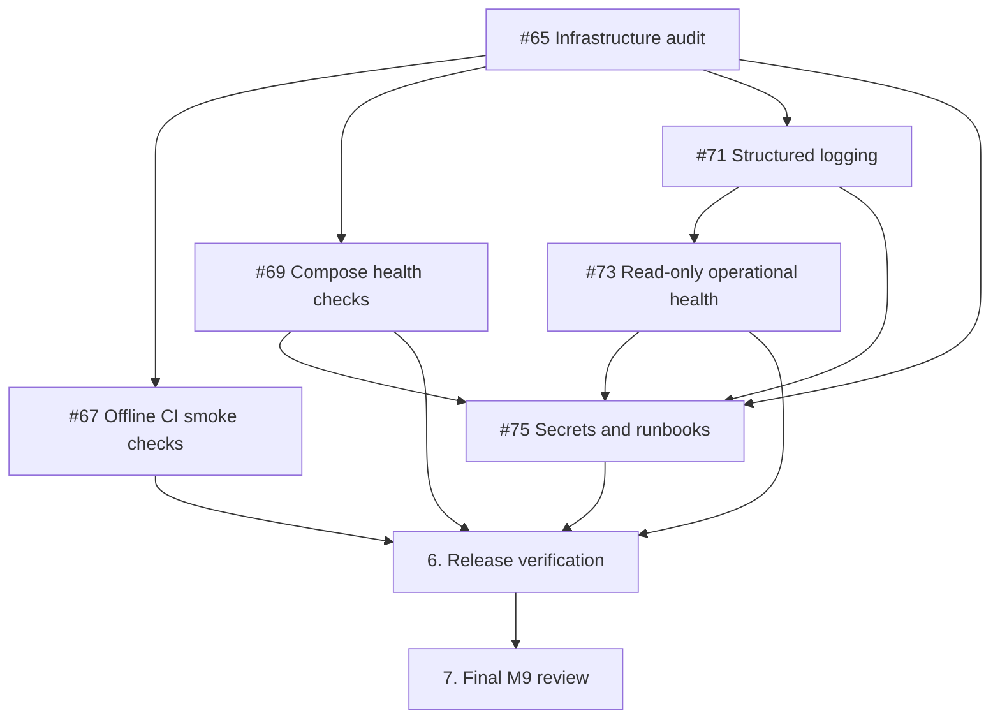

# M9 — CI/CD and observability implementation plan

**Parent audit:** Issue #65; see [`m9-infrastructure-audit.md`](m9-infrastructure-audit.md).
**Planning status:** infrastructure audit #65 merged; offline smoke verification is Issue #67. Compose health and validation is Issue #69; structured pipeline logging is Issue #71; pipeline health is Issue #73; secrets and operational runbooks are Issue #75; later issue numbers are intentionally unassigned.
**Goal:** reliable, observable, testable operation without accidentally enabling live ingestion or deploying to production.

## Guardrails and boundary

The current CI already runs Ruff, unit tests and isolated PostgreSQL integration tests. M8 already supplies a read-only pipeline monitoring page. M9 should build on these rather than replace them. Operations changes must leave the original ETL and analytics behavior intact and must keep `ENABLE_TWELVE_DATA_INGESTION=false`, `ENABLE_GOLD_LOADING=false`, the default-paused DAG, and the `financial_market_test` write restriction intact unless a later, separately reviewed production design explicitly provides safe alternatives. No M9 PR should commit `.env` or actual credentials.

## Recommended issue sequence

| Order | Proposed GitHub title | Priority | Dependency | Deliverable |
| --- | --- | --- | --- | --- |
| 1 | `ci: add offline Airflow DAG and dashboard smoke verification` (**#67**) | P1 | #65 | CI jobs or steps that run deterministic DAG import/structure and dashboard startup/build checks without API/network side effects. |
| 2 | `ops: add Airflow service health checks and Compose validation` (**#69**) | P1 | #65 | Version-compatible readiness/health probes, Compose configuration validation, local startup checks. |
| 3 | `observability: standardize pipeline logs and safe diagnostics` (**#71**) | P1 | #65 | Structured event fields, DAG/run correlation, masking tests, logger conventions. |
| 4 | `observability: implement read-only pipeline health assessment` (**#73**) | P1 | #65, ideally 3 | Assessed failed/stale-running runs with documented thresholds and no DB mutation; optional monitoring presentation or CLI. |
| 5 | `ops: document secrets, least privilege and operational runbooks` (**#75**) | P1 | #65, 2–4 | Safe configuration, read-only dashboard grants, startup/shutdown, backup/recovery guidance and incident checklist. |
| 6 | `ci: verify reproducible release artifacts and deployment readiness` | P1 | 1, 2, 5 | Deterministic container build/smoke, immutable tagging strategy, release checks and manual rollback plan. No automatic production deployment. |
| 7 | `test(ops): run M9 end-to-end reliability and CI review` | P1 | 1–6 | Offline failure drills, health/observability assertions, complete tests, documentation and final M9 sign-off. |

Each title is **proposed**, not an existing GitHub issue. Create the next issue only after the current item is reviewed/merged if you want to retain the established one-branch-at-a-time workflow.

## Issue acceptance criteria

### 1. Offline CI smoke verification

- Airflow DAG imports in a controlled image based on the repository's supported Airflow version, with correct task registration/dependencies and paused/catchup safeguards.
- Streamlit dashboard package imports and launches a bounded smoke check without a production DB, credentials or real Twelve Data calls.
- Jobs are deterministic, time-bounded, PR-triggered and green for the default configuration.
- Existing lint, unit and PostgreSQL integration jobs remain green.

### 2. Compose readiness and health

- Validate both Compose files and external shared-network prerequisites using safe, non-secret-bearing output.
- Add appropriate, tested probes for scheduler, API server and DAG processor where supported; distinguish liveness from readiness.
- Do not block on a probe that an Airflow service does not actually support; document limitations instead.
- Keep auth credentials secret, ports localhost-bound where possible, and named volumes intact.

### 3. Logging and diagnostics

- Adopt a Python logging format including UTC timestamp, subsystem, severity, and available DAG/run IDs; avoid logging private payloads.
- Preserve Airflow task log integration and readable failure traceback where safe.
- Add unit tests for log redaction and consistent correlation fields; do not write database credentials or provider tokens into logs.
- Clearly distinguish exceptions from rejected-record counts and disabled steps.

### 4. Pipeline health assessment

- Use existing read-only `pipeline_run` data to report recent failures and long-running executions using configurable, documented time thresholds.
- Cover missing/empty data and clock/UTC boundaries; avoid treating a zero counter as proof of failure.
- Do not claim that aggregate rejection counts identify violation codes.
- An external alert sender, if added, must be opt-in and separately configured; no unsolicited email/webhook delivery.

### 5. Secrets and operations runbook

- Document distinct roles for Gold/test/metadata DBs and recommend SELECT-only database access for the dashboard.
- Explain secret injection, rotation and safe handling of generated Airflow administrator credentials, without exposing values.
- Document startup order, verification, safe stop, retry/restore approach, log inspection, and incident triage.
- Address stale sections in `docs/airflow-local-setup.md` and the empty `README.md` or coordinate their resolution with M11 portfolio documentation.
- Describe backup and restore processes as procedures requiring operator approval; do not execute destructive commands.

### 6. Reproducible build and release readiness

- Produce or validate a deployable artifact for the dashboard and Airflow runtime, with reproducible dependency/build inputs where practical.
- Test builds and a bounded smoke check in CI without pushing to public registries by default.
- Document environment matrices, image provenance strategy, manual promotion and rollback steps.
- Deployment to an external host or automated production rollout requires a separate explicit decision and credentials; is not assumed to be enabled by this issue.

### 7. M9 end-to-end verification

- Run Ruff checks, all unit and isolated PostgreSQL integration tests, plus newly introduced offline runtime tests.
- Exercise safe failure/recovery scenarios (database unavailable, failed run, stale run, missing env/config) without live Twelve Data requests.
- Verify no secrets in test output or committed artifacts and no test fixtures in the primary Gold DB.
- Verify documentation against actual Compose and CLI commands and collect PR CI evidence.
- Close M9 only once all agreed issues and three existing quality gates plus new smoke checks pass.

## Dependency flow

The sequence is deliberately incremental: CI safety gates first, then runtime health and diagnostics, then operational procedures and release verification.

## Verification baseline and reporting

M8 reached a recorded **440-passing-test** checkpoint before its final verification issue; later counts must be taken from an actual fresh run on updated `main`. Do not bake a historical total into M9 acceptance criteria. For every M9 issue, record Ruff output, unit/integration tests, GitHub Actions checks, and whether any runtime tests used Docker. If a test is skipped because Docker or Airflow is unavailable, report it explicitly rather than calling the entire readiness review complete.

## Deferred beyond M9

- **M10 — Experiments & Evaluation:** sustained throughput, performance/load experiments, trend analysis, and quantified data-quality evaluation.
- **M11 — Portfolio Release v1.0:** public-facing packaging, polished repository overview, release notes, final reproducibility walkthrough, and versioned release.
- **M12 — Thesis:** academic write-up and presentation as a distinct track.
- **Requires a later deployment decision:** hosted cloud resources, production secret management service, automatic live ingestion schedules, external alerts with third-party credentials, and automated production rollouts.

## Definition of done for Issue #65

- This plan and the companion audit are reviewed, committed and merged.
- Findings clearly differentiate existing controls, observed gaps, and recommended enhancements.
- Proposed implementation issues have testable acceptance criteria and an ordering that avoids redundant M7/M8 work.
- No secrets, runtime service modifications, or database changes are introduced by the audit PR.
