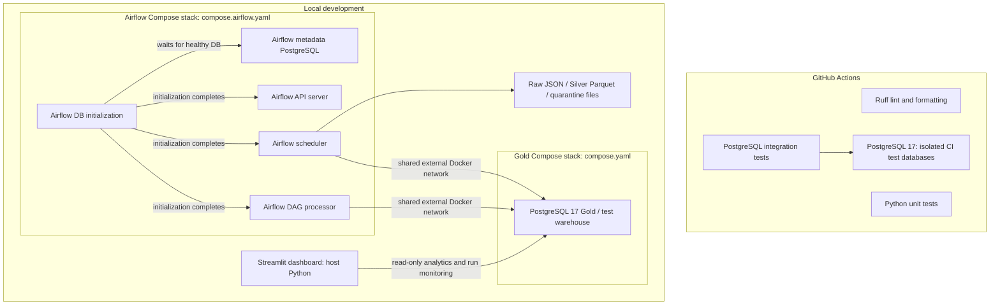

# M9 — CI/CD and observability infrastructure audit

**Issue:** #65 · **Scope:** repository configuration and selected source exported on 2026-11-01 · **Status:** static review, not a live deployment assessment.

## Executive summary

M1–M8 have supplied strong development controls: isolated PostgreSQL integration tests, migration management, safe-by-default Airflow orchestration, persisted pipeline execution metadata, and a read-only dashboard. M9 should **extend** those controls with deployment/build verification, observable health and failures, and an operational runbook. It should not duplicate the completed dashboard or ETL implementations.

The evidence is `m9-infrastructure-review.txt`, a snapshot of tracked configuration, Airflow code, selected scripts, and tests. This review did not inspect the entire repository, run Docker or GitHub Actions, check live workflow settings, or validate a production environment. Items marked **not established** mean the exported evidence does not establish them, not that the capability cannot exist elsewhere.

## 1. Inventory of confirmed capabilities

| Area | Confirmed existing implementation | Evidence |
| --- | --- | --- |
| CI triggers and permissions | `.github/workflows/ci.yml` runs on pull requests into `main` and pushes to `main`; workflow permissions limit `contents` to `read`; checkout disables persisted credentials. | `.github/workflows/ci.yml` |
| Python quality gates | Independent Ruff lint/format and database-independent pytest jobs, Python 3.11, pip caching via `setup-python`, job timeouts. | `.github/workflows/ci.yml`, `pyproject.toml` |
| Integration CI | PostgreSQL 17 started with `docker compose up -d --wait`; test DB identity verified; migration history and Gold schema applied to distinct `financial_market_test` and `financial_market_migration_test` DBs; integration tests execute; `always()` cleanup. | `.github/workflows/ci.yml`, `compose.yaml` |
| Warehouse infrastructure | PostgreSQL 17 has a persistent named volume, localhost-bound host port, `pg_isready` healthcheck, and shared external network. | `compose.yaml` |
| Airflow infrastructure | Airflow 3.1.7, `LocalExecutor`, dedicated metadata PostgreSQL, an init job, API server, scheduler, DAG processor, persisted authentication volume and file-based task logs; scheduler and processor use the shared network. | `compose.airflow.yaml`, `Dockerfile.airflow` |
| DAG safeguards | Daily UTC-aware DAG is initially paused, catchup disabled, one active run; explicit environmental and per-run authorization for Twelve Data ingestion and Gold loading. Live ingestion/Gold writes disabled by default. Gold loading is restricted to `financial_market_test`. | `airflow/dags/financial_market_pipeline.py`, `.env.example` |
| Execution tracking | Start and completion callbacks persist running/success/failed statuses, timestamps, durations; processing stages write extracted/validated/transformed/loaded/rejected snapshots. Tracking writes target the isolated test database. | `airflow/dags/financial_market_pipeline.py`, `src/financial_data_platform/orchestration/airflow_tracking.py`, `docs/airflow-local-setup.md` |
| Dashboard monitoring | Read-only PostgreSQL transaction and parameterized queries; source/status/inclusive UTC date filters, newest-first 500-run limit, displayed-run summaries. | `src/financial_data_platform/analytics/pipeline_monitoring.py` |
| Test tooling | Dedicated test runner and Airflow DAG/authorization verification scripts; monitored queries have isolated integration and unit tests. | `scripts/run_tests.py` (listed), `scripts/validate_airflow_dag.py`, `tests/integration/test_pipeline_monitoring_integration.py`, `tests/unit/test_pipeline_monitoring_queries.py` |
| Configuration conventions | `.env.example` documents secrets and disables ingestion/loading by default; published setup instructions prohibit committing `.env`. | `.env.example`, `docs/airflow-local-setup.md` |

**Note on evidence:** `scripts/run_tests.py` and `scripts/manage_migrations.py` are listed in the inventory but their contents were not included in this export. Their behavior is supported here only where CI invocations or documentation show it.

## 2. Service architecture and startup dependencies

The base Gold service and Airflow stack share an **external network** that must already exist. The Airflow `airflow-postgres` service has a healthcheck; `airflow-init` waits for it to become healthy, and the Airflow application services wait for successful initialization. The scheduler and DAG processor do not declare application-level healthchecks in the exported file. Airflow's API server is localhost-bound (`127.0.0.1`) in the supplied Compose file. A dedicated Streamlit Docker service is **not present in the exported Compose files**.

The Airflow scheduler and DAG processor build `Dockerfile.airflow` (Airflow 3.1.7 plus Psycopg 3). `airflow-init` and `airflow-api-server` instead use the stock `apache/airflow:3.1.7` image. This image split merits a runtime/compatibility review; it is **not evidence of a present failure**.

## 3. Findings and risks

**P0 = security or safety gate; P1 = required for M9 operating confidence; P2 = useful follow-up.** Priority assignments are proposed, not severity ratings from a scanner.

| ID | Priority | Observation / gap | Why it matters | Recommended response |
| --- | --- | --- | --- | --- |
| F-01 | P1 | CI has lint, unit, and PostgreSQL integration jobs, but no explicit Airflow-runtime DAG import/dependency test or dashboard build/smoke job in the exported workflow. | Runtime or packaging changes may escape Python-only checks. | Add deterministic offline Airflow import/structure smoke and dashboard startup/build verification, with bounded CI timeouts. |
| F-02 | P1 | Airflow application services lack explicit healthchecks in `compose.airflow.yaml`. | Container process running does not necessarily mean application service is ready. | Select version-compatible probes; validate in Docker before adding health-based dependencies. |
| F-03 | P1 | The tracking table records outcomes and counts, but automatic failure notification, stale-running-run detection, and actionable alert routing are not established. | Failures require manual inspection and may not be noticed. | Add read-only health assessment and safe, opt-in alert delivery; avoid false zero/negative inferences. |
| F-04 | P1 | Task and callback code uses `print`; Airflow log files are mounted locally. A consistent structured event format, correlation IDs, retention, and sensitive-data redaction policy are not established. | Troubleshooting and auditability suffer as runs accumulate. | Define Python/Airflow logging conventions with run identifiers; test masking of credentials and URL query parameters. |
| F-05 | P1 | No verified deployment pipeline, immutable image publication, environment-specific rollout, or rollback procedure is represented in the export. | Successful CI is not itself a deployable release. | Define reproducible build and verification gates; keep deployment manual and opt-in until authorization is explicit. |
| F-06 | P1 | Runtime connection to Gold uses `financial_market_test`, and tracking/Gold write safeguards explicitly restrict this DB; both ingestion and loading are disabled by default. | The current pipeline is intentionally not an unattended production system. | Preserve default-deny; design production role/environment separation before considering live automation. Do **not** remove guards simply to enable production. |
| F-07 | P1 | Secrets are passed using Compose environment interpolation; `.env.example` requires values but no proven secret store, rotation or least-privilege database role configuration is in the export. | Production secrets and dashboard write permissions need stronger controls. | Document secret injection, rotation and SELECT-only dashboard role; never print expanded `docker compose config` into reports. |
| F-08 | P2 | The exported `README.md` is empty; some `docs/airflow-local-setup.md` sections describe superseded intermediate milestones (e.g., claims that custom DAGs or Silver/Gold tasks are absent). | Operators may follow stale instructions. | Consolidate current startup, dependency, safe toggles, recovery, and troubleshooting runbooks. |
| F-09 | P2 | `pipeline_monitoring.py` limits retrieval to the newest 500 runs and calculates totals only across retrieved rows; violation details remain separate from aggregate rejection counts. | UI metrics are not global run totals or a quality-reason breakdown. | Retain accurate labels; consider lightweight read-only aggregate reporting in a later issue only if needed. |
| F-10 | P2 | CI uses Python 3.11 and pip cache already; a separate dependency cache improvement is not established as necessary. | Avoid duplicate optimization work. | Measure dependency install/build times before adding caching or lockfile changes. |
| F-11 | P2 | The workflow uses `ubuntu-latest` and action major versions, with no explicit container-image or dependency provenance verification shown. | Reproducibility/security could improve. | Evaluate image pinning, dependency review, supply-chain scanning and least-privilege permissions proportionately. |

### Specific safeguards that must survive M9

- Never enable live Twelve Data ingestion or Gold loading as an incidental smoke test.
- Never run fixture writers or destructive cleanup against the main `financial_market` database.
- Keep the Gold warehouse and Airflow metadata database distinct.
- Keep CI PostgreSQL databases disposable and clean up containers only in CI's isolated environment.
- Keep the Airflow DAG paused by default until an explicit operational decision authorizes scheduling.
- Do not expose API keys, JWT secrets, database passwords or generated Airflow admin credentials in docs, PR logs, or issue comments.
- Preserve read-only transaction semantics for Streamlit analytics and pipeline monitoring; recommend SELECT-only DB credentials for deployment.

## 4. Architecture decision proposed for M9

**Target for this milestone:** reproducible **local/CI operating profile** with operational health and CI smoke verification, not an unsolicited cloud/production rollout.

1. Retain existing PostgreSQL and Airflow Compose configurations as the development baseline.
2. Strengthen CI with isolated, offline smoke checks for the Airflow runtime and dashboard build/start behavior; no API requests or main-DB writes.
3. Add version-compatible service health signals and a read-only operational status assessment from `pipeline_run`.
4. Introduce structured, scrubbed diagnostic logs and a documented local operator runbook.
5. Require explicit provider, environment, credentials, and deployment approval before external hosting or automated delivery is implemented.

## 5. Verification and evidence limitations

This review is **static**. It does not prove operational uptime, PostgreSQL permission grants, actual Airflow runtime image compatibility, dashboard network reachability, secret rotation, or GitHub repository branch protection. Those require targeted, authorized checks in future issues. The export did not contain an exhaustive repository tree, all application modules, GitHub settings, workflow run results, or environment values.

Issue #65 adds documentation only; no application changes, SQL migrations, API calls, Docker operations or deployment changes are required to produce these findings.
